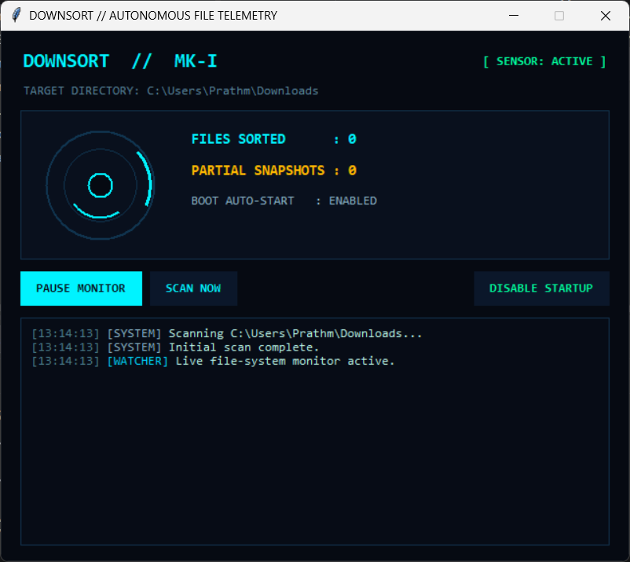

# DownSort

A lightweight Windows download organizer written in Python. It watches your `Downloads` folder in the background and automatically sorts files into folders named after their extensions.



## Why I built this
Most download sorters either poll the folder in an infinite loop (wasting CPU) or break active browser downloads by trying to move `.crdownload` / `.part` files mid-download. 

DownSort uses `watchdog` to react to Windows file-system events instead of polling, keeping idle CPU usage near 0% and RAM around ~20 MB.

## What it does
- **Dynamic extension sorting:** Creates uppercase folders (`PDF/`, `ZIP/`, `MP4/`, `EXE/`, etc.) automatically for whatever file type lands in `Downloads`.
- **Safe partial-download handling:** Leaves active `.crdownload`, `.part`, `.tmp`, and `.download` files untouched in `Downloads`, keeps a backup copy in `_In_Progress_Copies/`, and deletes that backup as soon as the browser finishes and renames the file.
- **No accidental overwrites:** Renames duplicates automatically (`report.pdf` -> `report_1.pdf`).
- **Dark Tkinter HUD:** Shows live logs, sorted/staged file counts, and quick Pause/Scan buttons.
- **Run on startup:** One-click toggle that adds/removes a silent `.vbs` launcher in your Windows `Startup` folder (`--minimized`).

## Project Files
- `sorter_engine.py` — File routing, duplicate handling, and partial-download staging logic
- `watcher.py` — `watchdog` event listener for created, modified, and renamed files
- `downsort_ui.py` — Tkinter interface and Windows startup toggle

## Setup

```bash
git clone [https://github.com/prathm-null/DownSort.git](https://github.com/prathm-null/DownSort.git)
cd DownSort
python -m venv .venv
.venv\Scripts\activate
pip install -r requirements.txt
python downsort_ui.py